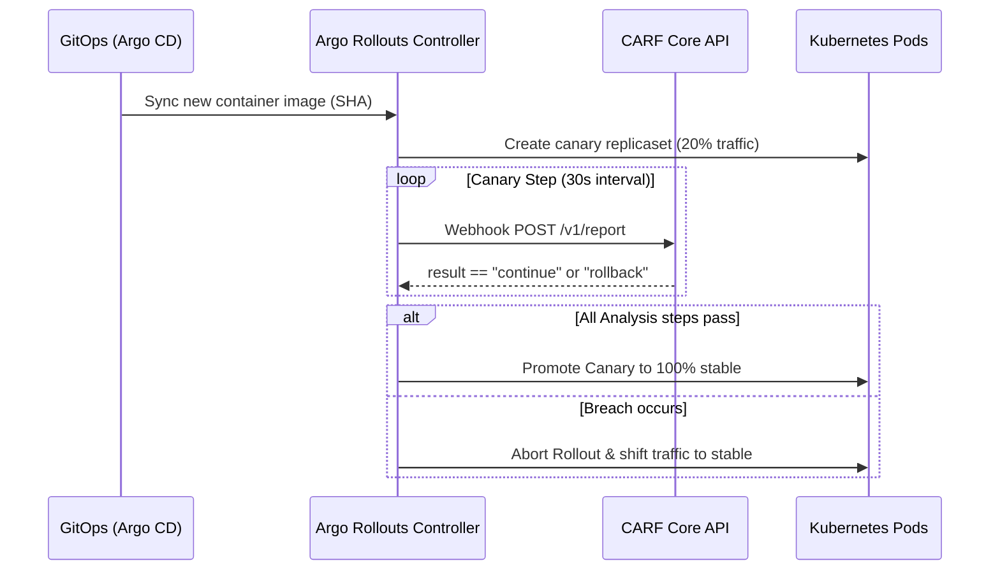

# Argo Rollouts Integration Guide

This guide describes how to connect CARF with **Argo Rollouts** for cloud-native progressive delivery on Kubernetes using custom `AnalysisTemplate` web metrics.

---

## Architectural Flow



---

## AnalysisTemplate Manifest (`analysis-template.yaml`)

Deploy the following `AnalysisTemplate` in your cluster:

```yaml
apiVersion: argoproj.io/v1alpha1
kind: AnalysisTemplate
metadata:
  name: carf-canary-metric
  namespace: default
spec:
  metrics:
  - name: carf-evaluation
    interval: 30s
    successCondition: result == "continue"
    failureLimit: 2
    provider:
      web:
        url: "https://api.carf.dev/v1/report"
        headers:
        - key: Authorization
          value: "Bearer YOUR_CARF_API_KEY"
        - key: Content-Type
          value: "application/json"
        jsonBody:
          sha: "{{args.target-sha}}"
          errorRate: 0.0
          healthy: true
```

---

## Rollout Definition (`rollout.yaml`)

Reference the `carf-canary-metric` in your Rollout strategy:

```yaml
apiVersion: argoproj.io/v1alpha1
kind: Rollout
metadata:
  name: api-service
spec:
  strategy:
    canary:
      analysis:
        templates:
        - templateName: carf-canary-metric
        args:
        - name: target-sha
          valueFrom:
            podTemplateHashValue: Latest
      steps:
      - setWeight: 20
      - pause: { duration: 1m }
      - setWeight: 50
      - pause: { duration: 2m }
```
