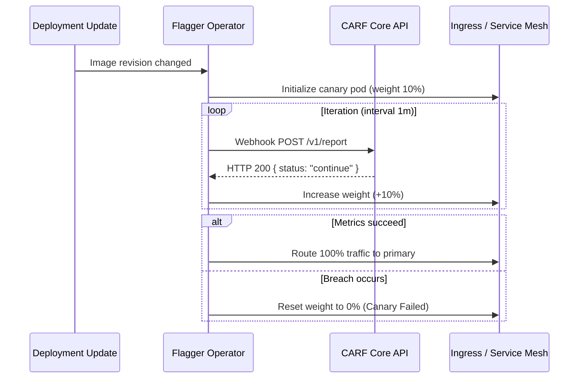

# Flagger Canary Integration Guide

This guide details configuring **Flagger** with CARF webhooks for progressive traffic shifting and automated rollbacks on Istio, Linkerd, Contour, or NGINX.

---

## Architectural Flow



---

## Canary CRD Manifest (`flagger-canary.yaml`)

```yaml
apiVersion: flagger.app/v1beta1
kind: Canary
metadata:
  name: api-service
  namespace: default
spec:
  targetRef:
    apiVersion: apps/v1
    kind: Deployment
    name: api-service
  service:
    port: 8080
    targetPort: 8080
  analysis:
    interval: 1m
    threshold: 2
    maxWeight: 50
    stepWeight: 10
    webhooks:
      - name: "carf-soak-verification"
        type: rollout
        url: "https://api.carf.dev/v1/report"
        timeout: 10s
        headers:
          Authorization: "Bearer YOUR_CARF_API_KEY"
```
