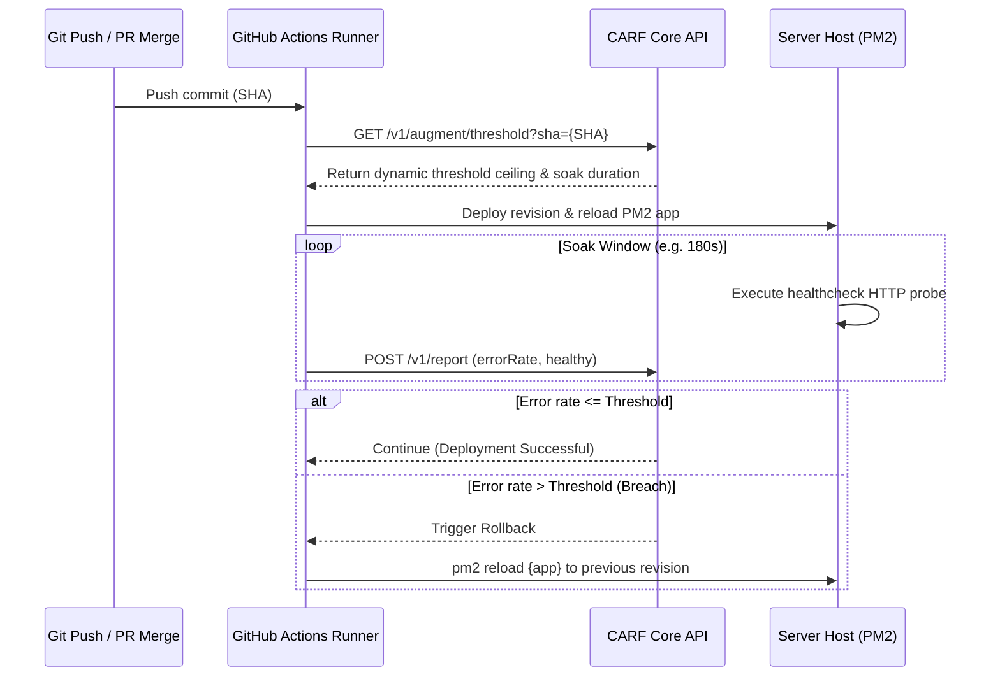

# GitHub Actions + PM2 Integration Guide

This guide details the setup and operational model for combining **GitHub Actions** CI/CD with a host-managed **PM2** runtime process.

---

## Architectural Flow



---

## Prerequisites

1. CARF GitHub App installed on the target repository with `Contents: Read and write` and `Actions: Read and write`.
2. Repository secret `CARF_API_KEY` configured in **Settings -> Secrets and variables -> Actions**.
3. PM2 running on the destination server managing your process (e.g., `ecosystem.config.js`).
4. HTTP health check endpoint exposed on the application (e.g., `/healthz` returning HTTP 200).

---

## Repository Configuration (`.carf.yml`)

Add `.carf.yml` to the root of your repository:

```yaml
version: "1.0"
mode: "augment"

target:
  runtime: "pm2"
  name: "my-web-app"
  health_url: "http://localhost:3000/healthz"

rules:
  window_seconds: 300
  base_ceiling: 0.05
  soak_duration: 180

ci:
  workflow_name: "CI"
  trigger_on_push: true
```

---

## Workflow Template (`.github/workflows/carf.yml`)

```yaml
name: CARF Deployment & Rollback Gating
on:
  push:
    branches: [ main ]
  workflow_run:
    workflows: ["CI"]
    types: [completed]
    branches: [ main ]

jobs:
  carf-deploy:
    runs-on: ubuntu-latest
    if: ${{ github.event_name == 'push' || github.event.workflow_run.conclusion == 'success' }}
    steps:
      - uses: actions/checkout@v4

      - name: Query Dynamic Risk Ceiling
        id: carf_threshold
        run: |
          RESP=$(curl -s -f -X GET \
            -H "Authorization: Bearer ${{ secrets.CARF_API_KEY }}" \
            "https://api.carf.dev/v1/augment/threshold?owner=${{ github.repository_owner }}&repo=${{ github.event.repository.name }}&sha=${{ github.sha }}")
          echo "ceiling=$(echo $RESP | jq -r .threshold)" >> $GITHUB_OUTPUT
          echo "soak=$(echo $RESP | jq -r .soakWindowSeconds)" >> $GITHUB_OUTPUT

      - name: Deploy Release
        run: |
          ssh deploy@host "cd /var/www/app && git pull && npm ci && pm2 reload my-web-app --update-env"

      - name: Health Soak Monitoring
        run: |
          curl -s -f -X POST "https://api.carf.dev/v1/report" \
            -H "Authorization: Bearer ${{ secrets.CARF_API_KEY }}" \
            -H "Content-Type: application/json" \
            -d '{"sha": "${{ github.sha }}", "errorRate": 0.0, "healthy": true}'
```
