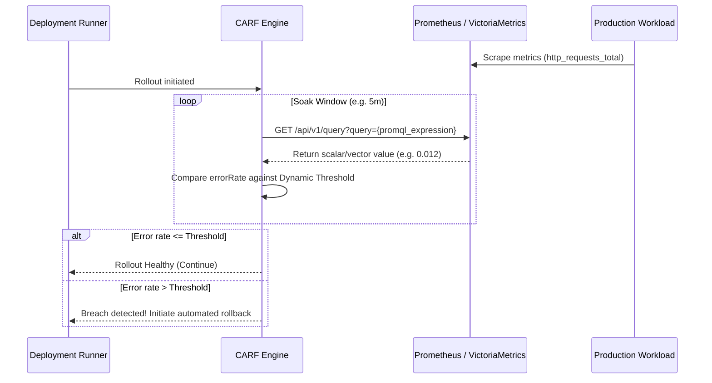

# Prometheus PromQL Telemetry Health Adapter Guide

The Prometheus PromQL adapter enables CARF to query Prometheus or VictoriaMetrics instant query APIs (`/api/v1/query`) to dynamically evaluate real-time HTTP error rates, 5xx ratios, and latency percentiles against dynamic risk thresholds.

---

## Architectural Flow



---

## Configuration (`.carf.yml`)

```yaml
version: "1.0"
mode: "augment"

telemetry:
  source: "prometheus"
  endpoint: "http://prometheus:9090"
  query: 'sum(rate(http_requests_total{job="api",status=~"5.."}[1m])) / sum(rate(http_requests_total{job="api"}[1m]))'
  timeout_ms: 5000

rules:
  window_seconds: 300
  base_ceiling: 0.02
```

---

## Useful PromQL Query Recipes

### 1. HTTP 5xx Error Rate Ratio
```promql
sum(rate(http_requests_total{service="my-service",status=~"5.."}[1m]))
/
sum(rate(http_requests_total{service="my-service"}[1m]))
```

### 2. High Error Rate Absolute Rate
```promql
sum(rate(http_requests_total{service="my-service",status=~"5.."}[1m]))
```

### 3. P99 Latency Breach Threshold (seconds)
```promql
histogram_quantile(0.99, sum(rate(http_request_duration_seconds_bucket{service="my-service"}[5m])) by (le))
```
